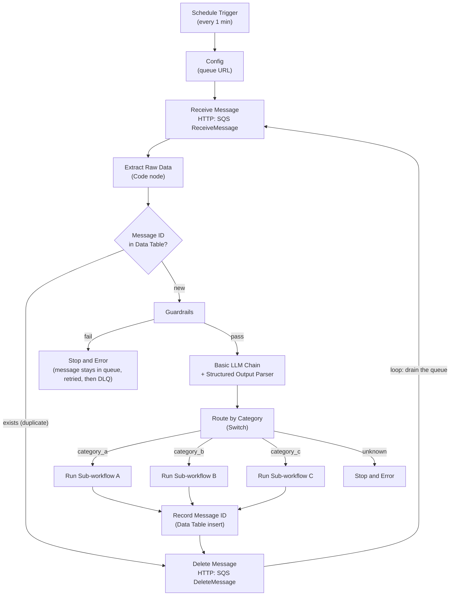
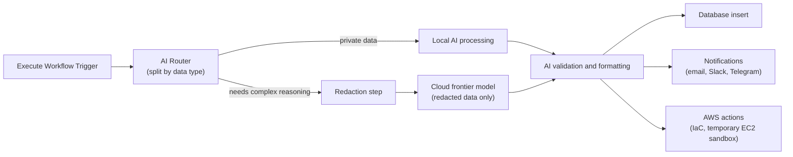

# SQS-Driven AI Classification & Routing Workflow (n8n)

An n8n workflow that consumes messages from an **AWS SQS** queue, screens and **classifies** the unstructured payload with an LLM, and **routes** each message to a dedicated sub-workflow. A message is deleted from the queue **only after its sub-workflow has finished successfully**, and a lookup table prevents the same message from being processed twice.

The n8n instance runs **on-prem**, so it cannot receive pushes from AWS. The workflow therefore **polls** SQS with a Schedule Trigger and the plain HTTP Request node signed with AWS credentials (n8n has no built-in SQS trigger).

> **Note:** This repository is a sanitized version of a real project. Queue names, account IDs, credentials, categories, prompts and sub-workflow logic have been replaced with placeholders. The architecture and reliability patterns are unchanged.

---

## Table of contents

1. [Use case](#use-case)
2. [Architecture](#architecture)
3. [How it works](#how-it-works)
4. [Reliability design](#reliability-design)
5. [Security and privacy design](#security-and-privacy-design)
6. [Sub-workflow pattern](#sub-workflow-pattern)
7. [Prerequisites](#prerequisites)
8. [Setup](#setup)
9. [Node reference](#node-reference)
10. [Testing](#testing)
11. [Troubleshooting](#troubleshooting)
12. [Design decisions and trade-offs](#design-decisions-and-trade-offs)
13. [Limitations and future improvements](#limitations-and-future-improvements)
14. [Repository contents](#repository-contents)

---

## Use case

Machine-generated log files arrive in an SQS queue as unstructured text. Before they can be processed, each one has to be:

- checked for unsafe or malicious content,
- classified into a category,
- routed to the right downstream automation (database inserts, notifications, AWS resource actions, further AI processing),
- and acknowledged (deleted from the queue) only when the work has actually succeeded.

Messages must not be silently lost, and they must not be processed twice.

## Architecture



## How it works

1. **Schedule Trigger** starts a run every minute.
2. **Config** holds the SQS queue URL in one place so it isn't repeated across nodes.
3. **Receive Message** calls the SQS JSON API (`AmazonSQS.ReceiveMessage`) with long polling (`WaitTimeSeconds: 10`) and a visibility timeout, signed via the n8n AWS credential.
4. **Extract Raw Data** parses the response (SQS returns it as a string under `data`) and emits one item per message with `messageId`, `receiptHandle` and `body`. An empty queue yields zero items, which ends the run.
5. **Duplicate check** uses two Data Table operations side by side, "If row exists" and "If row does not exist", on `messageId`:
   - Already seen: the message goes straight to **Delete Message**.
   - New: it continues down the pipeline.
6. **Guardrails** screens the message body before it reaches the LLM. Messages that fail are sent to **Stop and Error**; they are *not* deleted, so SQS redelivers them and, after the configured number of receives, moves them to the dead-letter queue (DLQ) for review.
7. **Basic LLM Chain** classifies the text using a structured output parser, so the model returns a machine-readable category (for example `{"category": "category_a"}`) instead of free text.
8. **Route by Category** (Switch) sends the message to the matching sub-workflow. Any value outside the allowlist goes to the fallback output, which raises an error rather than guessing.
9. **Run Sub-workflow** nodes execute the sub-workflow with **Wait for Sub-Workflow Completion** enabled, one call per item.
10. **Record Message ID** writes the `messageId` to the Data Table, **only after** the sub-workflow returned successfully.
11. **Delete Message** calls `AmazonSQS.DeleteMessage` with that message's `receiptHandle`.
12. The delete step loops back to **Receive Message** (which is set to *Execute Once*), so each run keeps draining the queue until it is empty.

## Reliability design

SQS standard queues are **at-least-once**: a message can occasionally be delivered more than once, and order is not guaranteed. The workflow is built around that.

| Concern | How it is handled |
|---|---|
| Message lost if processing fails | Delete happens **only after** the sub-workflow succeeds. On failure there is no delete, so the message reappears after the visibility timeout and is retried. |
| Poison messages | A DLQ with a `maxReceiveCount` collects messages that keep failing, so they cannot loop forever. |
| Duplicate delivery | A Data Table of processed `messageId`s. If an ID is found, the message is deleted without reprocessing. |
| Crash between "processed" and "deleted" | The ID is recorded *before* the delete, so the retry is recognized as a duplicate and just deleted. |
| Crash between "processed" and "recorded" | Narrow window; sub-workflows should be idempotent (deterministic resource names or tags derived from the `MessageId`, check-before-create). |
| Message hidden too briefly | Visibility timeout is set above the slowest sub-workflow runtime. |
| One message per receive call | Long polling returns as soon as one message is available, so the workflow loops (delete, then receive again) until the queue is empty. |
| Hot loop on a failing message | A failing message never reaches Delete, so the loop ends and the next scheduled run retries after the visibility timeout. |
| Parallel receive calls | **Execute Once** on the Receive node prevents one receive per deleted item. |

**Why the ID is recorded after success, not before:** inserting the ID first means a crash mid-processing would cause the retry to be treated as "already processed" and deleted, silently losing the message.

## Security and privacy design

- **Untrusted input.** Log content is untrusted. The Guardrails node screens it before any LLM sees it, and failing messages are quarantined (retry, then DLQ) instead of deleted.
- **Prompt injection containment.** The LLM only produces a **label from a fixed allowlist** (via the structured output parser). The Switch maps labels to fixed sub-workflows; model output is never used as parameters for AWS or infrastructure calls. Unknown labels fail closed.
- **Least-privilege IAM.** The n8n credential has only the SQS actions it needs, scoped to a single queue (see [Setup](#setup)).
- **Data residency.** The classifier model is swappable. For sensitive data, use a local or on-prem model; only redacted data without sensitive information is allowed to reach cloud-hosted frontier models. The example workflow uses an OpenAI chat model node, which you can replace with a local model node (for example Ollama).
- **Secrets.** No credentials live in the workflow JSON, only references to n8n credentials. Do not commit credential exports.

## Sub-workflow pattern

Each category maps to a sub-workflow with an **Execute Workflow Trigger**. A typical sub-workflow looks like this (illustrative, the real logic is redacted):



Rules every sub-workflow must follow:

1. **Fail loudly.** Any path that means "this message was not handled" must end in a **Stop and Error** node. If a sub-workflow finishes normally, the parent treats it as success and deletes the message.
2. **Be idempotent.** A retry must be safe: use deterministic names or tags derived from the `MessageId`, and check for existing resources before creating new ones.
3. **Redact before cloud calls.** Redaction should be a deterministic step, not left to an AI decision.

## Prerequisites

- n8n (self-hosted) with **Data Tables** available
- An AWS account with an SQS queue
- An IAM user or role for n8n
- An LLM provider for the classifier (cloud or local)
- AWS CLI (optional, for testing)

## Setup

### 1. SQS queue

- Create a standard queue (or use an existing one).
- **Visibility timeout:** longer than your slowest sub-workflow (the Receive node also sets `VisibilityTimeout` per call, currently 300 seconds).
- **Dead-letter queue:** create one and set `maxReceiveCount` (for example 5).
- Check the queue's maximum message size. For large logs, store the file in S3 and send only a pointer in the message.

### 2. IAM policy

Attach to the identity whose keys n8n uses (replace region, account ID, queue name):

```json
{
  "Version": "2012-10-17",
  "Statement": [
    {
      "Effect": "Allow",
      "Action": [
        "sqs:ReceiveMessage",
        "sqs:DeleteMessage",
        "sqs:GetQueueAttributes"
      ],
      "Resource": "arn:aws:sqs:us-east-1:<account-id>:<queue-name>"
    }
  ]
}
```

A producer needs `sqs:SendMessage` on the same queue.

### 3. n8n credentials

- **AWS** credential: access key, secret key, region `us-east-1` (the region must match the endpoint URL).
- **LLM** credential for the Chat Model node.

### 4. Data Table

Create a Data Table with one column:

| Column | Type |
|---|---|
| `messageId` | string |

Optionally schedule a cleanup of rows older than a few days. SQS retains messages for at most 14 days, so older IDs are no longer needed.

### 5. Import and configure

1. In n8n choose **Import from File** and select `workflow.json`.
2. Set `queueUrl` in the **Config** node (`https://sqs.us-east-1.amazonaws.com/<account-id>/<queue-name>`).
3. Select the AWS credential on **Receive Message** and **Delete Message**.
4. Select your Data Table on **Already Processed**, **New Message** and **Record Message ID**.
5. Point **Guardrails** and **Basic LLM Chain** at the message body from **Extract Raw Data** (for example `{{ JSON.stringify($json.body) }}`), and adjust the classification prompt and categories.
6. Select your sub-workflows in the three **Run Sub-workflow** nodes.
7. Activate the workflow.

## Node reference

| Node | Type | Purpose |
|---|---|---|
| Schedule Trigger | Schedule Trigger | Starts a polling run every minute |
| Config | Set | Holds the SQS queue URL |
| Receive Message | HTTP Request | `AmazonSQS.ReceiveMessage`, long polling, AWS-signed; *Execute Once* |
| Extract Raw Data | Code | Parses the SQS response into `messageId`, `receiptHandle`, `body` |
| Already Processed | Data Table | Passes items whose `messageId` exists |
| New Message | Data Table | Passes items whose `messageId` does not exist |
| Guardrails | Guardrails | Screens the message body before the LLM |
| Stop and Error (unsafe) | Stop and Error | Fails the run for unsafe content; message is not deleted |
| Basic LLM Chain | LLM Chain | Classifies the message |
| OpenAI Chat Model | Chat Model | Model used by the chain (swappable) |
| Structured Output Parser | Output Parser | Forces a JSON category result |
| Route by Category | Switch | Maps category to sub-workflow; fallback output for unknown |
| Run Sub-workflow A/B/C | Execute Workflow | Waits for completion; error output left unconnected |
| Unknown Category | Stop and Error | Fail-closed on unexpected labels |
| Record Message ID | Data Table | Inserts the ID after sub-workflow success |
| Delete Message | HTTP Request | `AmazonSQS.DeleteMessage` using the message's receipt handle |

## Testing

Send a test message:

```bash
aws sqs send-message \
  --queue-url https://sqs.us-east-1.amazonaws.com/<account-id>/<queue-name> \
  --message-body "sample log line: service=api status=500 ..." \
  --region us-east-1
```

Scenarios worth running:

| Scenario | Expected result |
|---|---|
| Normal message | Classified, routed, sub-workflow succeeds, ID recorded, message deleted |
| Same logical message resent | New `MessageId`, so it is processed again (dedup is per `MessageId`; use a business key in the payload if you need payload-level dedup) |
| Redelivered message (simulate by failing right after the sub-workflow) | Found in the Data Table, deleted without reprocessing |
| Sub-workflow ends in Stop and Error | No record, no delete, message returns after the visibility timeout, eventually lands in the DLQ |
| Content that trips Guardrails | Run errors, message not deleted, retried then DLQ |
| Classifier returns an unexpected label | Switch fallback raises an error, message not deleted |
| Several messages queued | Loop drains them one pass at a time until empty |
| Empty queue | Code node returns no items, run ends cleanly |

## Troubleshooting

| Symptom | Cause and fix |
|---|---|
| Code node outputs nothing | The HTTP node returns the SQS response as a string in `data`. The Code node parses it; check the parsing logic if you changed it. |
| `SignatureDoesNotMatch` or region errors | The AWS credential region must match the endpoint (`us-east-1`). |
| `AccessDenied` | Check the IAM policy actions and the queue ARN. |
| Only one message per receive | Expected with long polling; the loop handles it. |
| Messages appear out of order | Expected on standard queues; use FIFO if order matters. |
| Message reprocessed repeatedly | Visibility timeout shorter than processing time, or the sub-workflow keeps failing. Check the DLQ. |
| Classification never routes | Confirm the Switch expression points at the field where the parser puts the category. |

## Design decisions and trade-offs

- **Polling with the HTTP Request node instead of a community SQS trigger node.** No dependency on third-party packages, full control over delete timing, works with outbound-only network access. The cost is manual response parsing and a polling delay.
- **Polling instead of SQS to Lambda to webhook.** The on-prem n8n instance is not reachable from AWS. A push model would give instant delivery but needs inbound connectivity.
- **Delete-on-success, record-after-success.** Prioritizes never losing a message over never retrying one; idempotent sub-workflows absorb the retries.
- **Label-only LLM output.** Constraining the model to an allowlisted label limits the impact of prompt injection compared with letting it produce actions or parameters.
- **Wait-for-completion sub-workflows.** Simpler correctness (success is known before delete) at the cost of longer-running parent executions.

## Limitations and future improvements

- Extend the visibility timeout mid-run (`ChangeMessageVisibility`) for slow paths instead of one long static timeout.
- Use `DeleteMessageBatch` and parallel receivers if throughput grows.
- Store large payloads in S3 and pass pointers through SQS.
- Alert on DLQ depth (CloudWatch alarm to Slack or email).
- Move to a FIFO queue if ordering or built-in deduplication becomes necessary.
- Add a unique constraint or an upsert on the dedup table to close the race between overlapping runs.
- Add metrics (processed count, failures per category, classification latency).
- Replace keyword checks in Guardrails with a broader set (jailbreak, PII detection) tuned to the log format.

## Repository contents

```
.
├── README.md        # this document
└── workflow.json    # sanitized n8n workflow export
```

## License

Add your preferred license here (for example MIT).
